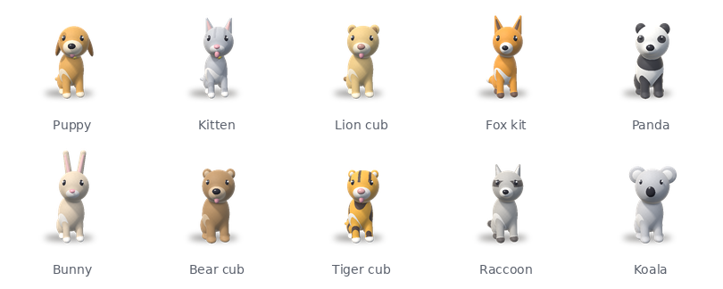

# meetcap

meetcap records your meetings on a Mac. When a call ends you get a transcript, notes if you want them, and one page where every meeting is searchable. It works without any cloud account. Add one only if you want to.



## What it does

- Starts recording when Teams, Zoom or Webex picks up your microphone, whether or not the meeting itself is being recorded. You can also double-click the pet on your desktop to record anything else.
- Captures your screen, your microphone and the other people's audio, on separate tracks.
- After the call it writes a transcript with timestamps. If you've picked a notes provider, it also writes a summary with action items, decisions, open questions and highlights. Screenshots are taken whenever the screen changes.
- Opens the notes in your browser when they're ready. Click any timestamp to hear that moment.
- Keeps everything in a folder on your Mac, or in Azure Blob Storage.

## What you need

- macOS 14 or newer
- [Homebrew](https://brew.sh)
- About 3 GB of free disk space for OBS, Python and the speech model
- An Apple Silicon Mac, for free transcription on the Mac. On an Intel Mac, pick a cloud engine such as Groq, which has a free tier.

The installer gets everything else, including [OBS](https://obsproject.com), the free app meetcap uses to record.

## Install

```bash
git clone https://github.com/VamsiChapa/meetcap.git
cd meetcap
./install.sh
```

It takes about 10 minutes, mostly downloads. When it's done, the setup screen opens in your browser. [INSTALL.md](INSTALL.md) walks through it step by step, including the macOS permission prompts.

## Pick your services

You choose one service for transcripts and one for notes. Both can be free.

| Service | Transcripts | Notes | Cost | Key |
|---|---|---|---|---|
| Whisper on this Mac | yes | no | free, and nothing leaves your Mac | none |
| Ollama on this Mac | no | yes | free, and nothing leaves your Mac | none ([install Ollama](https://ollama.com/download)) |
| Groq | yes | yes | free tier: about 8 hours of audio a day | [console.groq.com/keys](https://console.groq.com/keys) |
| OpenRouter | yes | yes, free models through `openrouter/free` | pay as you go; free notes models | [openrouter.ai/keys](https://openrouter.ai/keys) |
| Claude (Anthropic) | no, the API doesn't accept audio | yes, and it reads the screenshots | pay as you go | [console.anthropic.com](https://console.anthropic.com/settings/keys) |
| OpenAI | yes | yes | pay as you go | [platform.openai.com](https://platform.openai.com/api-keys) |
| Azure OpenAI | yes | yes | your Azure subscription | from your resource |
| Azure AI Speech | yes, with speaker labels | no | your Azure subscription | from your resource |

For a fully free and private setup, pick Whisper on this Mac with Ollama. For the least setup, pick Whisper on this Mac with Groq.

Notes can be switched off. You still get the recording, the transcript and the notes page, just without a summary. Transcripts can be switched off too, and then meetcap keeps the audio.

## Where meetings are kept

By default meetings go in `~/MeetCap`, a plain folder. No account needed. If you pick a folder inside OneDrive, Google Drive, Dropbox or iCloud Drive instead, that app backs your meetings up for you. The notes page is a file in the same folder, so it opens even when meetcap isn't running.

You can also use Azure Blob Storage, with a connection string, a container SAS URL or `az login`. Run `meetcap reader` once and you get a notes page that reads straight from Azure. Before it changes anything on the storage account it asks you (it needs one read-only browser rule). Teams can create the storage, Speech and OpenAI resources with the Terraform in `infra/terraform`.

## Everyday use

| To | Do this |
|---|---|
| Record a meeting | Nothing. Join the call. |
| Record something else (in person, a browser call) | Double-click the pet, or use the menu bar, or run `meetcap start` and `meetcap stop` |
| Read your notes | The page opens after each meeting. Bookmark it, or use **Open meeting notes** in the menu bar, or run `meetcap notes` |
| Change any setting | `meetcap setup` |
| Change the pet | `meetcap pet list`, then for example `meetcap pet koala` |
| Check that everything works | `meetcap doctor --deep` |
| Retry a meeting that failed | `meetcap retry` |
| Process a recording you already have | `meetcap process ~/Downloads/call.mp4` |

## The notes page

- Each meeting reads as one document: the summary first, then action items you can tick off, highlights, decisions, key points, open questions, risks and what was on screen.
- Every timestamp plays the audio from that point.
- In the transcript, each speaker's lines are grouped into paragraphs. Clicking a sentence plays it, and **Follow** keeps the page in step with the audio.
- A **Video** tab plays the screen recording, and the highlights under it jump the video.
- Search covers titles, notes and full transcripts.
- You can set text size, font, line width and light or dark mode, and print or save a meeting as a PDF.

## Desktop pets

Pick one of ten: puppy, kitten, lion cub, fox kit, panda, bunny, bear cub, tiger cub, raccoon or koala. The pet walks along the bottom of your screen and shows what meetcap is doing:

- sitting: waiting
- headphones and a red dot: recording
- a notepad: writing notes
- asleep: auto-record is off
- an orange **!**: something needs you

Drag it anywhere, and double-click it to start or stop a recording.

## Privacy and consent

Tell people you're recording. meetcap records even when the meeting app shows no banner, and in many places everyone on the call has to agree, not just you. Your employer may have rules of its own. Following them is on you.

With Whisper and Ollama nothing leaves your Mac. A cloud transcription service gets the audio; a cloud notes service gets the transcript and screenshots. Read their data policies before you send them anything confidential. Free models on OpenRouter come and go, and some of the companies behind them keep what you send.

API keys live in your macOS Keychain. meetcap never writes one to its config, its logs or your notes. The Azure notes link can only read, and `meetcap reader --revoke` switches off every copy of it at once.

## Troubleshooting

| Problem | Try |
|---|---|
| A call isn't recorded | `meetcap mics` during the call shows which app holds the mic. Browser calls need `detection.browsers` set in `meetcap setup`, or record them by hand |
| "Recording was silent" or the screen is black | System Settings → Privacy & Security: allow **OBS** under Microphone and under Screen & System Audio Recording. Then click **Set up OBS** in `meetcap setup` |
| OBS keeps crashing during setup | `meetcap obs-log` names the cause of each crash |
| Notes are missing | `meetcap jobs` shows each meeting's step and error; `meetcap doctor --deep` tests every service |
| The notes page doesn't open | `meetcap reader` rewrites it and opens it |

## How it works

A menu bar agent watches which apps hold the microphone through Core Audio. When a meeting app does, the agent drives OBS over its websocket. Each finished recording goes through a queue of small, restartable steps:

1. check the file
2. extract the audio
3. store the media
4. transcribe
5. take screenshots
6. write notes
7. publish the notes page
8. clean up

A step that fails is retried later, with longer waits each time. Each service is a small adapter class, so adding a new one means one class and one entry in `providers.py`.

See [docs/architecture.md](docs/architecture.md) for the design and [sdk-reference.md](sdk-reference.md) for the Python API.

## Development

```bash
python3.12 -m venv .venv
.venv/bin/pip install -e ".[dev]"
.venv/bin/pytest            # needs ffmpeg for the media tests
```

The pets are rendered with `tools/render_pet3d.py`, a small ray-marcher. Run `python tools/render_pet3d.py --species fox` to redraw one.

## Uninstall

```bash
./uninstall.sh            # keeps your settings, keys and meetings
./uninstall.sh --purge    # also removes settings and keys; your meetings folder is never touched
```

## License

MIT. See [LICENSE](LICENSE).
